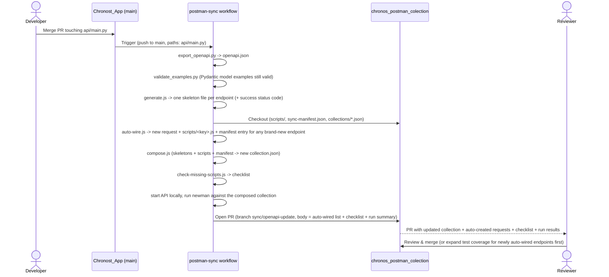

# Chronos — Postman Collections

This repository stores Postman collections for the Todo App API. The collections are intended primarily for **manual testing in Postman**.

Since this repository is used only for manual testing, there is no need for a paid Postman subscription. All changes to collections are made in the free version of Postman and synced to the repository via export and commit.

> Automated API tests are maintained in a separate repository:
> [chronos_mocha_rest_soap_testing](https://github.com/jirivondra/chronos_mocha_rest_soap_testing)

## Repository Structure

```
collections/
  todo-app.postman_collection.json   ← main collection
environments/
  local.postman_environment.json     ← local environment (localhost:8000)
scripts/
  <method>_<path>.js                 ← hand-written scripts that pass values between requests (only for endpoints that need one)
sync-manifest.json                   ← maps each endpoint key to the request name it syncs into
ci/
  check-collection.mjs               ← checks a newman run of the collection (see "Collection Check" below)
.github/workflows/
  collection-check.yml               ← runs the collection against a live API on every PR and push to main
```

## Prerequisites — Running the Application Locally

To use these collections and get relevant API responses, you need to have the application running locally.

Clone and set up the application from the [todo_app repository](https://github.com/jirivondra/todo_app) and follow the instructions in its [README](https://github.com/jirivondra/todo_app#readme).

## How to Import the Collections

1. Clone this repository:
   ```bash
   git clone https://github.com/jirivondra/chronos_postman_colection.git
   ```

2. Open Postman → click **Import**

3. Drag and drop or select the files:
   - `collections/todo-app.postman_collection.json`
   - `environments/local.postman_environment.json`

4. In the top right corner of Postman, select the **Todo App - Local** environment

5. Start the application locally and begin testing

## How to Update the Collections

**Method, URL and path changes are automated — including brand-new endpoints.** Whenever `api/main.py` changes in [Chronost_App](https://github.com/jirivondra/Chronost_App), a workflow there regenerates the request shapes from the OpenAPI spec, automatically creates a request + a minimal status-code test for any endpoint that isn't wired up yet, runs the resulting collection with `newman` against a live local instance of the API, and opens a PR here with the update. The PR body lists any newly auto-created endpoint, any request missing a test script, or whose example `body` fields have drifted from the spec (missing a new field, or still sending one that's gone) — plus a pass/fail summary from the live collection run. Review and merge it like any other PR.



If the live collection run fails, the PR still opens (diff stays visible), but the Chronost_App workflow run itself is marked failed so it isn't missed.

The sync never touches `header`, `body`, or the request's test/pre-request scripts, and it never touches folders or requests that aren't listed in `sync-manifest.json` — but the Collection Check fails on any such request (see [Collection Check](#collection-check-newman)), so in practice every request is mapped to an endpoint. See [`postman-sync/README.md`](https://github.com/jirivondra/Chronost_App/blob/main/postman-sync/README.md) in Chronost_App for the pipeline implementation details.

**Always manually review a sync PR before merging it, even when the checklist says "nothing to review."** The checklist only catches endpoints with no request or no script wired up — it doesn't verify the request still behaves correctly. Before merging:

1. Check the diff — confirm the changed method/URL actually matches the intended API change
2. Run the collection (Collection Runner) against a local instance of the API and confirm the requests still return the expected responses
3. If the API change added/removed a field, update the request `body` by hand — the sync deliberately never touches it

To change a script:

1. Edit the matching file in `scripts/<method>_<path>.js` (e.g. `scripts/post_todos.js`), exporting `prerequest` and/or `test` as template-literal strings
2. Commit and push — the next sync PR will pick it up

A brand-new endpoint needs no manual setup — the moment it appears in the spec, the sync PR already includes a new request (with a realistic example body) and a basic status-code test in `scripts/<key>.js`, wired up in `sync-manifest.json`. After merging that PR:

1. Move the auto-created request to a different folder if `Todos` isn't the right place for it
2. Delete the generated status-code test from `scripts/<key>.js` (see [Scripts](#scripts) — this collection holds no tests). Keep the file only if the endpoint produces a value other requests should reuse; the sync checklist will then list the endpoint as having no script, which is expected
3. From then on it stays in sync automatically, exactly like every other endpoint

Everything else not covered by the automated sync (environment values, request bodies) is still exported and committed manually:

1. Make your changes in Postman
2. Right-click the collection → **Export JSON** → save over `collections/todo-app.postman_collection.json`
3. To export the environment: click `...` next to the environment → **Export** → save over `environments/local.postman_environment.json`
4. Commit and push the changes:
   ```bash
   git add collections/ environments/
   git commit -m "fix: update collection"
   git push
   ```

## Endpoints

| Method | Endpoint | Description |
|--------|----------|-------------|
| GET | `/todos` | List all todos |
| POST | `/todos` | Create a new todo |
| GET | `/todos/{id}` | Get a todo by ID |
| PUT | `/todos/{id}` | Update a todo |
| DELETE | `/todos/{id}` | Delete a todo |

## Authentication

The API uses **HTTP Basic Auth**.
Default credentials for the local environment: `admin` / `secret`

## Request Chaining

`Create Todo` is the starting point — it creates a todo and stores its values in collection variables. Every other request reads them through `{{variable}}` placeholders in its URL or body, which Postman fills in automatically when you click **Send**. No script is needed on the reading side.

| Variable | Set by | How | Used by |
|----------|--------|-----|---------|
| `due_date` | `Create Todo` (pre-request) | today + 7 days, `YYYY-MM-DD` | `Create Todo` body, `Update Todo` body |
| `todo_id` | `Create Todo` (post-response) | `id` of the todo just created | URL of `Get Todo by ID`, `Update Todo`, `Delete Todo` |

Typical manual flow:

1. **Create Todo** → `todo_id` now points to the new todo
2. **Get Todo by ID** / **Update Todo** / **Delete Todo** → all target that todo, in any order
3. **Create Todo** again → `todo_id` is overwritten, subsequent requests target the new todo

Notes:

- Calling `Get` / `Update` / `Delete` before any `Create Todo` sends an unresolved `{{todo_id}}` and fails — create a todo first.
- `Delete Todo` doesn't clear `todo_id`. Calling `Get Todo by ID` afterwards returns `404` for the deleted todo, which is the expected, readable result.
- To check the current value of a variable, hover over `{{todo_id}}` in the URL, or open the collection's **Variables** tab.
- `due_date` is generated with `moment`, which is built into the Postman sandbox. `dayjs` isn't, and `pm.require('npm:...')` doesn't work in `newman` (which the Collection Check uses), so don't switch to it.
- A due date of +7 days falls inside the Dashboard's "Upcoming" window (today … today + 7). Delete todos you no longer need, so they don't skew the Playwright Dashboard tests running against the same backend.

## Scripts

This collection is for **manual calls only**. Its scripts do exactly one thing: **pass values from one request to the next** (see [Request Chaining](#request-chaining)). There are no `pm.test` assertions anywhere — not even status codes.

It also holds **only successful calls**, one per endpoint: open a request, click **Send**, get a working response. Error cases (`401`, `404`, `422`, …) are test scenarios, not something to call by hand — they're covered by the Mocha suite, so don't add them here.

API testing (status codes, response shape, field values, schemas, negative scenarios) lives in [chronos_mocha_rest_soap_testing](https://github.com/jirivondra/chronos_mocha_rest_soap_testing) (Mocha) and must not be duplicated here.

Before adding a script, ask: *"does it store a value that another request reads via `{{variable}}`?"* If not, it doesn't belong in this collection.

## Collection Check (newman)

Every pull request here (including the sync PRs opened by Chronost_App) and every push to `main` runs the **Collection Check** workflow (`.github/workflows/collection-check.yml`). It shows up as a ✅/❌ check right on the PR:

1. Checks out [Chronost_App](https://github.com/jirivondra/chronost_app) (`main`), starts its API and exports the OpenAPI spec
2. Runs this collection with **newman** (Postman's command-line runner) against that live API
3. `ci/check-collection.mjs` checks every request in the run:
   - it returns the **success status code** the OpenAPI spec declares for the endpoint it's mapped to in `sync-manifest.json` (`201` for Create, `204` for Delete, `200` otherwise)
   - its response is **JSON** whenever it has a body
   - no **`{{variable}}`** is left unresolved in the sent request (the `todo_id` chain works)
   - a request not mapped to any endpoint fails, since it doesn't belong in this collection

   Script errors and requests with no response fail it too.
4. The per-request table (expected vs. actual status, result) is shown in the run's summary in **Actions**.

The collection holds no `pm.test` assertions. newman records every request's status code anyway, and `ci/check-collection.mjs` does the checking outside the collection.

To run the same check locally, with the API running on `localhost:8000`:

```bash
npx newman@6.2.1 run collections/todo-app.postman_collection.json \
  -e environments/local.postman_environment.json \
  --reporters cli,json --reporter-json-export newman-results.json
# openapi.json: exported from Chronost_App with `python api/export_openapi.py > openapi.json`
node ci/check-collection.mjs --results newman-results.json --spec openapi.json \
  --manifest sync-manifest.json --out collection-summary.md
```

## Newman vs. Mocha — What Each One Checks

They answer different questions and **neither can replace the other**:

| | **Newman** (Collection Check, this repo) | **Mocha** ([chronos_mocha_rest_soap_testing](https://github.com/jirivondra/chronos_mocha_rest_soap_testing), run in Chronost_App CI) |
| --- | --- | --- |
| Question it answers | "Is **this Postman collection** usable?" | "Does **the API** work correctly?" |
| What it runs | The requests stored in `collections/todo-app.postman_collection.json` | Its own requests, written in TypeScript |
| Catches | A request not returning its **success status code** (e.g. a broken URL after a sync), a non-JSON response, a crashing script, a broken `todo_id` chain | Wrong status codes (incl. 401/404/422), wrong response shape (JSON Schema via `expectJsonSchema`), broken filters/pagination |
| Misses | Response content and shape, every error case — it only calls each endpoint once, successfully | Anything broken in the Postman collection — it never uses it |

Mocha can't take over newman's job: it never opens the collection, and running it means executing its `pm.*` scripts and `{{variable}}` substitution — which only Postman's runtime (newman) does.

Examples:

- **API breaks in its responses** (e.g. `GET /todos/{id}` drops the `title` field) → Mocha fails (JSON Schema). Newman still passes: the status code is still `200`.
- **Collection breaks** (e.g. a pre-request script crashes, as `await` did in the old auto-create scripts) → Newman fails. Mocha still passes: the API itself is fine.

In short: newman tests the **tool**, Mocha tests the **product**.

> Chronost_App's sync workflow also runs newman before opening a sync PR, but its result only lands in that repo's Actions and the PR body — from 2026-09-14 to 2026-10-18 crashing scripts went unnoticed that way, and sync PR #13 was merged with them. The Collection Check here is what puts a failing check on the sync PR itself.

To run the whole collection at once, use the **Collection Runner** (the ▶ button next to the collection).

## Using with Other Tools

The collections are stored in Postman Collection v2.1 format, which is supported by other API clients as well. This means you are not locked into Postman — the same collections can be used in tools like Bruno or Insomnia with a one-time import:

- **Bruno** — guide for importing Postman collections: [docs.usebruno.com](https://docs.usebruno.com/get-started/import-export-data/postman-migration)
- **Insomnia** — supports Postman collection import via File → Import
